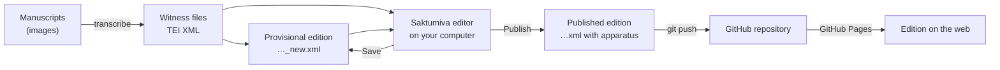
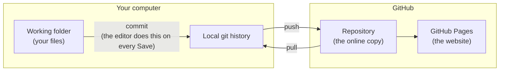
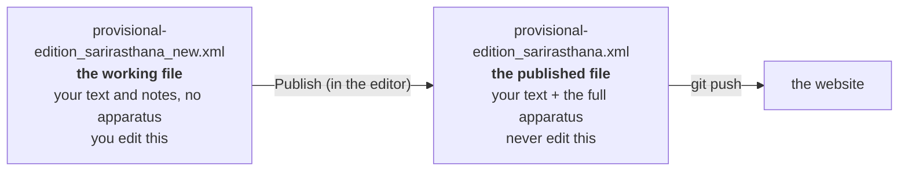
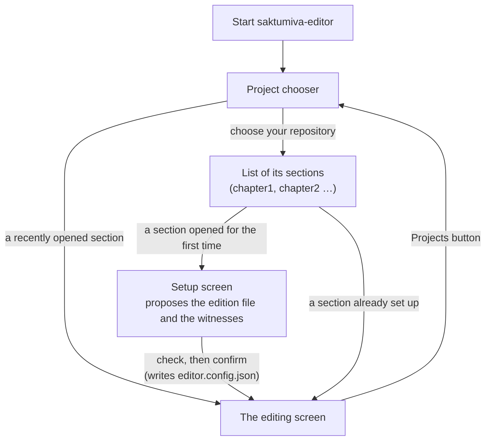
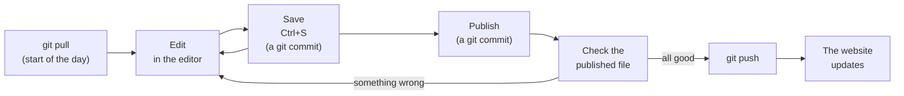

# Getting started with the Saktumiva editor

A tutorial for new users: from your first manuscript transcription to an edition published on the web.

[Saktumiva](https://github.com/chchch/saktumiva) is Charles Li's software for collating multi-witness texts and
making a critical apparatus. The **Saktumiva editor** is a screen that runs on your own computer and puts
Saktumiva's collation to work while you edit: you see each passage of your edition, the apparatus Saktumiva makes
for it, and every witness's text side by side, and your decisions are written straight back into your TEI files.

This tutorial assumes no knowledge of git or GitHub, and only a little of XML. It has eight parts:

1. [Transcribing manuscripts in TEI XML](#1-transcribing-manuscripts-in-tei-xml)
2. [A GitHub repository for your edition](#2-a-github-repository-for-your-edition)
3. [Creating a provisional edition file](#3-creating-a-provisional-edition-file)
4. [The working file and the published file](#4-the-working-file-and-the-published-file)
5. [Finding and installing the editor](#5-finding-and-installing-the-editor)
6. [Checking for updates](#6-checking-for-updates)
7. [Opening your files in the editor](#7-opening-your-files-in-the-editor)
8. [The work cycle: edit, save, publish, push](#8-the-work-cycle-edit-save-publish-push)

Short videos for each part are planned; their scripts are in [video-scripts.md](video-scripts.md).

The whole journey at a glance:



---

## 1. Transcribing manuscripts in TEI XML

Every witness (a manuscript, or a printed edition) is transcribed into its own file in
[TEI XML](https://tei-c.org). TEI is a large vocabulary, but Saktumiva needs very little of it. The rules are
given on the Saktumiva website, on the page [TEI tagging](https://saktumiva.org/wiki/tei), with the
[transcription conventions](https://saktumiva.org/wiki/transcription) on a page of their own.

### The two things Saktumiva must have

1. **A siglum**, in the header: `<idno type="siglum">K</idno>`. This is the name the witness has in the apparatus.
2. **An `xml:id` on every passage**: each verse (`<lg>`) or paragraph (`<p>`) carries a unique id, and the
   *same* passage carries the *same* id in every witness and in the edition. That is how Saktumiva knows which
   pieces of text to collate with which. Ids must begin with a letter, e.g. `SS.3.1.1` or `ch1.12`.

Verse lines go in `<l>` inside `<lg>`. Choose an id scheme at the start and keep to it: book, chapter and verse
(`SS.3.1.1` = Suśrutasaṃhitā, book 3, chapter 1, passage 1) works well.

### A minimal witness file

```xml
<?xml version="1.0" encoding="UTF-8"?>
<TEI xmlns="http://www.tei-c.org/ns/1.0">
  <teiHeader>
    <fileDesc>
      <titleStmt>
        <title>MS Kathmandu KL 699: Śārīrasthāna</title>
      </titleStmt>
      <publicationStmt>
        <p>Your project's name</p>
      </publicationStmt>
      <sourceDesc>
        <msDesc>
          <msIdentifier>
            <settlement>Kathmandu</settlement>
            <institution>Kaiser Library</institution>
            <idno>699</idno>
            <idno type="siglum">K</idno>
          </msIdentifier>
        </msDesc>
      </sourceDesc>
    </fileDesc>
  </teiHeader>
  <text>
    <body>
      <pb n="68v"/>
      <lg xml:id="SS.3.1.1">
        <l>athātaḥ sarvabhūtacintāṃ śārīraṃ vyākhyāsyāmaḥ ||</l>
      </lg>
      <p xml:id="SS.3.1.3">sarvabhūtānāṃ kāraṇam akāraṇaṃ ...</p>
    </body>
  </text>
</TEI>
```

The quickest way to get a complete header is Charles Li's [TST editor](https://tst-project.github.io/editor):
choose *new file*, fill in at least the fields marked in red, and put the siglum in the *Text id* field.
If the manuscript's images are online with a IIIF manifest, put the manifest's address in the *IIIF manifest*
field: the Saktumiva editor will then show you the page image beside each passage.

### The small set of transcription tags

Transcribe diplomatically: what the scribe wrote, including corrections and damage, in IAST (with the ISO 15919
exceptions given in the conventions). The Saktumiva website lists the tags for that; the ones you will use most are:

| Tag | For | Example |
|---|---|---|
| `<pb n="…"/>` | a new page or folio | `anekaviṣayanihi<pb n="3r"/>tapadānām` |
| `<lb n="…"/>` | a new line | `vya-<lb n="5"/>vahāre` |
| `<caesura/>` | the caesura of a verse line | `ya<caesura/>thā` |
| `<subst>`, `<del>`, `<add>` | the scribe's own corrections | `sarva<subst><del rend="crossed out">vidyā</del><add place="right-margin">śabdā</add></subst>nām` |
| `<choice>`, `<orig>`, `<corr>` | your correction of the scribe | `va<choice><orig>ṃta</orig><corr>rta</corr></choice>tamānaḥ` |
| `<sic>` | as written, uncorrected | `viśeṣo<sic>pa</sic>dhiḥ` |
| `<gap/>` | text you cannot read | `sā<gap reason="damaged" unit="akṣara" quantity="5"/>rvārthyam` |
| `<unclear>` | text you can read only doubtfully | `svarūpānyathā<unclear>t tānāpapaptiḥ</unclear>` |
| `<supplied>` | text you have supplied | `ta<supplied>d</supplied> dravyam` |
| `<space/>` | a blank in the manuscript | `<space unit="akṣara" quantity="2"/>` |
| `<note>` | a note in the manuscript (or by you) | `<note place="inline">(pa॰ 1|1|16)</note>` |

The others (`<hi>`, `<metamark>`, `<milestone>`, `<pc>`, `<retrace>`, `<surplus>`) are on the
[TEI tagging](https://saktumiva.org/wiki/tei) page.

**Tip.** You do not need to transcribe everything before you start. Transcribe the first few verses from two or
three witnesses, go through parts 2 to 7 of this tutorial, and see your first apparatus. Then carry on.

### Script notes

If a scribe does not distinguish two letters (śa and sa, ba and va …), say so in the header and the editor will
not report those differences as variants for that witness:

```xml
<physDesc>
  <scriptDesc>
    <scriptNote xml:id="script-śa-sa">śa and sa not distinguished.</scriptNote>
  </scriptDesc>
</physDesc>
```

---

## 2. A GitHub repository for your edition

### Why GitHub?

Your edition will be **published from GitHub**: GitHub keeps your files, and its free *GitHub Pages* service
turns the repository into a website where anyone can read the edition with its apparatus. Along the way you also
get a complete history of every change, a backup, and an easy way to work with collaborators.

There are two copies of your work, and **git** keeps them in step:



* A **commit** is a saved version in your local history. The Saktumiva editor makes one for you every time you
  save or publish, so you rarely need to do this yourself.
* **Push** sends your new commits to GitHub. Nothing goes online until you push.
* **Pull** fetches commits from GitHub, for example a collaborator's work, or changes you made on another computer.

### Creating the repository

1. Make a free account at [github.com](https://github.com) if you do not have one.
2. Click **+ → New repository**. Give it a short name without spaces (e.g. `Rasendramangala`), choose **Public**
   (GitHub Pages is free for public repositories), tick **Add a README file**, and click **Create repository**.
3. Get a copy on your computer ("clone" it). Two ways:
   * **GitHub Desktop** (recommended if you are new to git): install it from
     [desktop.github.com](https://desktop.github.com), sign in, choose **File → Clone repository**, pick your new
     repository and a folder on your disk, and click **Clone**.
   * **The command line**: on the repository's page, click the green **Code** button, copy the address, and run

     ```bash
     git clone https://github.com/YOUR-NAME/YOUR-REPOSITORY.git
     ```

You now have a folder on your disk that is linked to the repository on GitHub. Everything for your edition goes in
it.

### How to lay out the folder

The editor works with **sections**: one folder for each chapter (or other unit), holding that chapter's edition
file and its witness files. A repository with several chapters looks like this:

```
Rasendramangala/                     ← the project (your repository)
├── README.md
├── chapter1/                        ← a section
│   ├── provisional_edition_ch1_new.xml
│   ├── a1_ahmedabad_ldi_9442_ch1.xml
│   ├── g_gondal_34_ch1.xml
│   ├── l_london_ch1.xml
│   └── alignments/                  ← made by the editor
├── chapter2/
│   └── …
```

A text with only one part can have a single section: the files go straight into the repository's top folder.

### Keeping the two copies in step

Make these two habits:

* **Before you start work: pull.** In GitHub Desktop, click **Fetch origin**, then **Pull origin** if it appears.
  On the command line: `git pull`.
* **When you finish: push.** In GitHub Desktop, click **Push origin**. On the command line: `git push`.

If you add files yourself (a new witness transcription, say), commit them first. In GitHub Desktop, tick the files,
write a short summary at the bottom left ("Add transcription of MS L, chapter 1"), and click **Commit to main**.
On the command line:

```bash
git add chapter1/l_london_ch1.xml
git commit -m "Add transcription of MS L, chapter 1"
git push
```

**A word about Dropbox, OneDrive and iCloud.** If your repository is in a synced folder and you work on it from two
computers, the sync service and git can get in each other's way. GitHub already gives you the backup and the copy on
your other computer: clone the repository there too, and pull before you start.

### Turning on the website

Once you have published something (part 8), switch on GitHub Pages: on the repository's page go to
**Settings → Pages**, under *Build and deployment* choose **Deploy from a branch**, branch **main**, folder
**/ (root)**, and click **Save**. After a minute or two your files are on the web at
`https://YOUR-NAME.github.io/YOUR-REPOSITORY/`, and a published edition file opens at, for example,
`https://YOUR-NAME.github.io/YOUR-REPOSITORY/chapter1/provisional_edition_ch1.xml`.

For the published file to display as a readable edition rather than raw XML, the section needs Saktumiva's page
style, `edition.xsl`, and the TST script library that goes with it. Charles Li's
[setup instructions](https://chchch.github.io/saktumiva/docs/) say where to get them: `edition.xsl` goes in the
section folder (the editor then links it automatically when it publishes), and the TST libraries in a folder
`lib/`. The simplest way is to copy the arrangement of an existing project such as the
[Suśrutasaṃhitā](https://github.com/sushrutaproject1/Sushrutasamhita_Saktumiva2).

---

## 3. Creating a provisional edition file

The edition file is the text *you* establish. It has the same structure as a witness file, with the same
`xml:id`s, but the text in it is your edited text. At the start it is only provisional: a first version that you
will improve passage by passage in the editor.

The easiest way to make one:

1. **Copy your best witness**, or a printed edition if there is one (the "vulgate"). Its text will be your starting
   point.
2. **Name the copy so that the editor recognises it**: the name should contain `edition`, and a working copy should
   end in `_new`, e.g. `provisional-edition_sarirasthana_new.xml` or `provisional_edition_ch1_new.xml`.
3. **Change the header**: the `<title>` (e.g. "Rasendramaṅgala, chapter 1: provisional edition"), and give the
   edition its own siglum, e.g. `<idno type="siglum">Ed</idno>`. Take out the manuscript description that you
   copied.
4. **Clean the text**: remove the witness's page and line breaks (`<pb/>`, `<lb/>`), its corrections and its other
   diplomatic markup, so that what remains is plain edited text in `<lg>`/`<l>` and `<p>` elements.
5. **Check the ids**: every passage that should be collated must have the same `xml:id` as in the witnesses. A
   passage you have not edited yet can stay as an empty `<lg xml:id="SS.3.1.2"><l/></lg>`; the editor still lists
   it, and you can fill it in later.
6. **Commit** the new file (see part 2).

A passage of an edition file looks like this:

```xml
<lg xml:id="SS.3.1.1">
  <l>athātaḥ sarvabhūtacintāṃ śārīraṃ vyākhyāsyāmaḥ ||</l>
</lg>
```

You do **not** write any apparatus yourself. Saktumiva makes it from the witnesses, and the editor keeps it up to
date as you edit.

---

## 4. The working file and the published file

Each section has two edition files with almost the same name. It matters which is which:



* **`…_new.xml`, the working file.** This is the master copy of your edition: the text and your notes, and nothing
  else. Every **Save** in the editor writes to it. You may also open it in another XML editor (Oxygen, VS Code …).
* **`….xml` (without `_new`), the published file.** **Publish** writes it from the working file: your text exactly
  as it stands, plus the list of witnesses, the link to the page style, and a complete apparatus for every
  passage, made by Saktumiva's own code. This is the file readers see on the website.

The published file is **output**. Do not edit it by hand: the next Publish replaces it, and your changes would be
lost. Correct the working file (or a witness), then publish again.

When you open a section for the first time, the editor proposes which file is which. It takes a file whose name
contains "edition" and ends in `_new` (or `_working`, `_draft`) as the working file, and a file that already contains
a Saktumiva apparatus as published output. If there is no published file yet, Publish writes
`<working file name>_with-apparatus.xml`. To publish to the name without `_new` instead, type that name into the
**Publish to** field of the setup screen (part 7). It is stored in the section's `editor.config.json`:

```json
"publishTo": "provisional-edition_sarirasthana.xml"
```

---

## 5. Finding and installing the editor

The editor lives on GitHub at
[github.com/sushrutaproject/saktumiva2-editor](https://github.com/sushrutaproject/saktumiva2-editor). There are
two ways to install it.

### The ready-made program (easiest)

1. Go to the [latest release](https://github.com/sushrutaproject/saktumiva2-editor/releases/latest).
2. Under **Assets**, download the file for your computer (its name contains `linux`, `macos` or `windows`).
3. Unzip it, and put the program somewhere you will find it again.
4. Run `saktumiva-editor` (on Windows, `saktumiva-editor.exe`).

A terminal window opens, and the editor opens in your web browser. **Leave the terminal window open while you
work**; closing it (or pressing Ctrl+C in it) stops the editor. If you start the editor again while it is still
running (perhaps in a terminal window you forgot about), it does not start a second copy: it opens the running one in
your browser.

The first time only:

* **macOS**: the program is not signed by Apple, so macOS refuses to open it with a double-click. Right-click it and
  choose **Open**, then **Open** again. (The ready-made program is for Apple silicon Macs, M1 and later; on an older
  Intel Mac, use pipx.)
* **Windows**: SmartScreen may warn about an unknown publisher. Click **More info → Run anyway**.

### With pipx (for Python users)

If you have Python 3.10 or later and [pipx](https://pipx.pypa.io):

```bash
pipx install git+https://github.com/sushrutaproject/saktumiva2-editor.git
```

Then type `saktumiva-editor` in a terminal.

You also need **git** installed for the editor to keep the history of your saves (GitHub Desktop users on Windows
and macOS: install git as well, from [git-scm.com](https://git-scm.com)). Without git the editor still works, but
it tells you that saves are not versioned.

---

## 6. Checking for updates

In the editor, open **Help ▾ → Check for updates…**. The editor asks GitHub whether there is a newer release. If
there is, it tells you what has changed and how to update, in the way that fits how you installed it:

* **Ready-made program**: a link to the new download. Download it, unzip it, and replace the old program with it.
* **pipx**: a command to copy into a terminal, of the form `pipx install --force …`.

Then stop the old copy (close its terminal window, or press Ctrl+C in it) and start the new one. If you forget, the
new version tells you that an older copy is still running, and where.

You can also check from a terminal:

```bash
saktumiva-editor --check-updates
```

and see which version you have with `saktumiva-editor --version`, or under **Help ▾ → About**.

Updating the editor never touches your files: your transcriptions and edition live in your repository, not in the
program.

---

## 7. Opening your files in the editor

Start the editor. The first screen is the **project chooser**:

* **Recently opened** lists the last six sections you worked on, most recent first. Click one to go straight to it,
  or click **Project…** beside it to see that project's other sections.
* Otherwise, under **Open a folder**, type the path of your repository's folder, or press **Browse…**, find the
  folder and press **Use this folder**.



The chooser lists the sections it finds in the project. The first time you open a section, the **setup screen**
shows what the editor proposes:

* **Edition**: the working file, the text you edit (`…_new.xml`);
* **Witnesses**: the transcriptions collated with it;
* **Publish to**: the file Publish writes (part 4).

Check it carefully, change it if necessary, and press **Create editor.config.json and open**. The editor saves your
choice as `editor.config.json` in the section folder; commit and push that file along with the rest. To change it
later, use **Change which files are the edition and the witnesses** in the chooser.

You can also start the editor on a folder directly from a terminal:

```bash
saktumiva-editor ~/git/Rasendramangala                         # choose one of its sections
saktumiva-editor ~/git/Sushrutasamhita_Saktumiva2/03-su.sa     # open this section straight away
```

### The editing screen


Its parts:

```
┌────────────────────────────────────────────────────────────────────────────────────────┐
│ ☰ Saktumiva editor  chapter1   Undo Redo [Save] Publish History Settings Projects Help▾ ☰ │
├──────────────┬──────────────────────────────────────────┬──────────────────────────────┤
│ Find…        │ ◀ SS.3.1.3 ▶  Edit text  TEI source  Add note │ Witnesses               │
│ SS.3.1.1     │                              A−  A  A+   │ ⠿ K  athātaḥ … [image] [edit] │
│ SS.3.1.2     │  the passage, as in your edition file    │ ⠿ N  athātaḥ … [image] [edit] │
│ SS.3.1.3  •  │  (underlined words have variants)        │  …                           │
│ …            ├──────────────────────────────────────────┤                              │
│              │ Apparatus              Correct alignment │  page image                  │
│              │  sarvva° ] sarva° K N           [use]    │  (when you open one)         │
│              ├──────────────────────────────────────────┤                              │
│              │ Notes                                    │                              │
└──────────────┴──────────────────────────────────────────┴──────────────────────────────┘
```

* **Passage list** (left): every passage with an `xml:id`. Type in the box at the top to find a passage or words.
  A dot marks a passage with unsaved changes.
* **Text** (centre): the passage as it stands in your working file. Underlined words have variants; click one to
  find its apparatus entry.
* **Apparatus**: made by Saktumiva for this passage. The first time you open a passage, the editor collates it
  (this may take a moment for long prose passages; afterwards the result is kept).
* **Witnesses** (right): each witness's text of the passage, with buttons for its page image and for correcting
  its transcription. Drag a witness by its handle (⠿) to put the list in the order you like; witnesses that lack
  the passage are always listed last.

Make the screen fit your way of working: the **☰** button at the far left (or the [ key) hides and shows the
passage list, and the **☰** at the far right (or the ] key) the witnesses. **A− A A+** above the text (or
Ctrl+−, Ctrl+0, Ctrl++) change the size of the text. The editor remembers these choices, and the order of the
witnesses, the next time you start it.

If your edition's header contains a stemma (a `<stemma format="nexml">`, as SplitsTree6 and Saktumiva write it), a
**Stemma** button appears in the top bar and draws it, with the sigla at the leaves. **Download SVG** saves the
drawing. Making a stemma is beyond this tutorial: see Charles Li's guide, listed at the end.

**Help ▾ → Using the editor** describes every part of the screen.

---

## 8. The work cycle: edit, save, publish, push



### Edit

In the editor you can:

* **Choose a reading from the apparatus**: point at a reading and press **use**. It goes into your text, the
  passage is collated again, and the old reading becomes a variant.
* **Type in the text**: **Edit text** (or key E). Grey boxes are markup (caesura, anchors, page breaks); they are
  protected, but you can delete them. Tick **Record as emendation** to add an emendation note at the same time.
  **TEI source** lets you edit the passage as XML for anything else.
* **Add a note**: select a word and press **Add note here**. The editor creates the anchor in the text and the note
  together, with matching ids.
* **Correct a witness's transcription**: **edit** beside the witness. This is saved at once to the witness file.
* **Correct the alignment**, when Saktumiva has lined the witnesses up wrongly: **Correct alignment** (or key A).

**Undo** (Ctrl+Z) works until you save.

### Save

**Save** (Ctrl+S) writes the passages and notes you changed into the working file (`…_new.xml`), and nothing else:
the rest of the file keeps its own formatting. Each save is a git commit that lists what you changed, so you can
always go back (**History** shows the saved versions).

Before saving, the editor checks that the file has not been changed by another program in the meantime, that the
result is well-formed XML, and that the `xml:id`s are still unique. If you also use Oxygen or another XML editor,
save there and reload the editor before going on, or the editor will refuse to overwrite your other changes.

Save often. Saving does not publish anything.

### Publish

When you have done a piece of work, press **Publish**. The editor writes the published file: your working file plus
a fresh apparatus for every passage (see part 4). Passages that need collating are collated first; this can take
some minutes the first time for a long section, and is quick afterwards. At the end the editor lists any passages
that have no apparatus (for example, passages that no witness contains). The published file and the updated alignment
files are committed together.

### Check

Look at the published file before you push it: open it in your XML editor, or look at the diff in GitHub Desktop
(the *Changes* and *History* tabs show exactly what changed). If something is wrong, go back to the editor, fix it
in the working file, save, and publish again.

### Push

When you are happy, **push** (GitHub Desktop: **Push origin**; command line: `git push`). Your commits, the working
file, the published file and the alignment files go to GitHub, and a minute or two later the website shows the new
version of your edition.

### A typical day

1. Pull.
2. Start the editor and open your section.
3. Work through some passages, saving as you go.
4. Publish, and check the result.
5. Push.
6. Close the editor's terminal window.

---

## Where to find more

* The editor's [README](../README.md): every setting, the project file `saktumiva-project.json`, and what the editor
  cannot yet do.
* Charles Li, [Reconstructing a Pali, Sanskrit, Tamil, or Tibetan text using computers](https://chchch.github.io/saktumiva/docs/):
  the full Saktumiva method, including trees and stemmatic reconstruction.
* [Saktumiva.org](https://saktumiva.org): transcription conventions and TEI tagging.
* Projects that use the editor: the [Suśrutasaṃhitā](https://github.com/sushrutaproject1/Sushrutasamhita_Saktumiva2)
  and the [Rasendramaṅgala](https://github.com/wujastyk/Rasendramangala).
